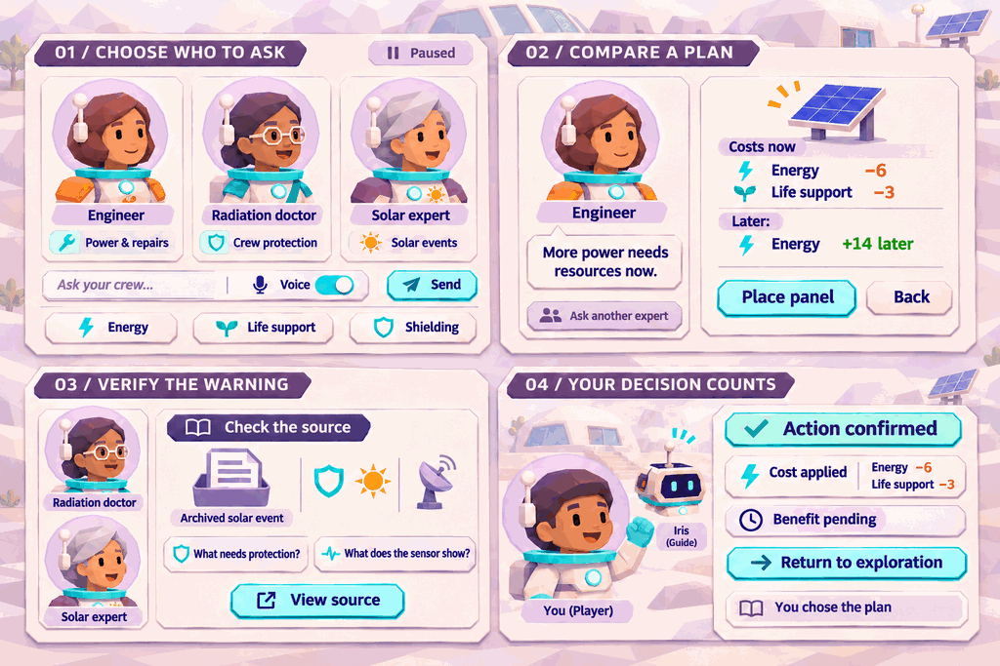
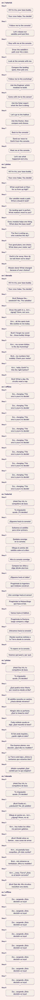

# B1 — líneas para A

`lineasGlobo(paso, nivel)` entrega cada globo por separado; no concatenar los dos del tutorial.
`bienvenidaGlobo(nivel)` entrega el saludo. Traducir cada `Linea` con el i18n existente.
No ejecutan acciones ni cambian el motor. El diálogo largo sigue en la franja de E5.

| Referencia canónica | Captura del banco de textos con el CSS real de F4 |
| --- | --- |
|  |  |

Medición: `BASE_URL=http://localhost:5210 node agents/evals/medir-globo.mjs`.
94 globos (EN/ES, bienvenida, ocho pasos y cuatro niveles), ninguno supera dos renglones.
La captura es un banco de textos, no evidencia de integración en la escena (A2 pendiente).
Validado: npm ci, typecheck, vitest (926 pruebas), build de ui.
No verificado en esta entrega: e2e y globo anclado en la escena.
