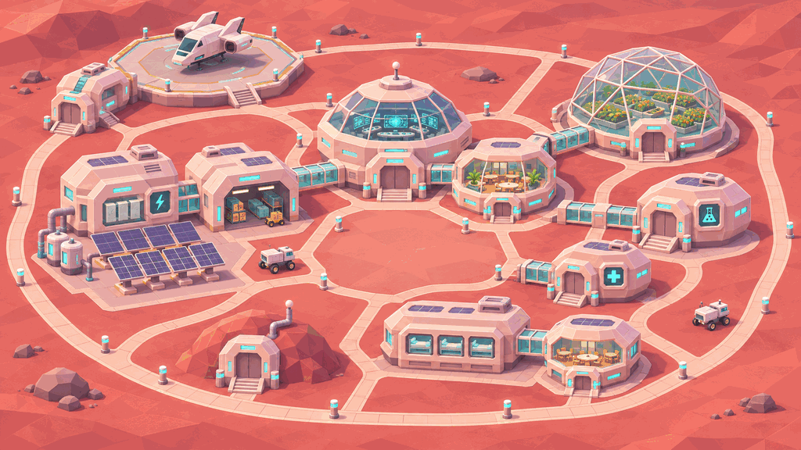
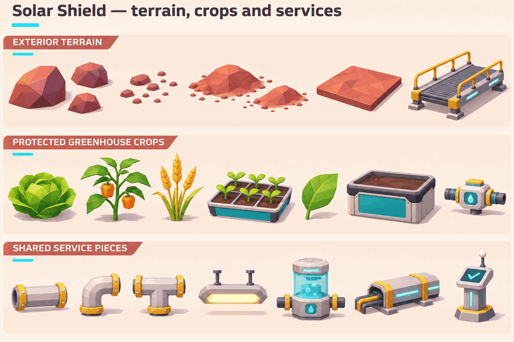
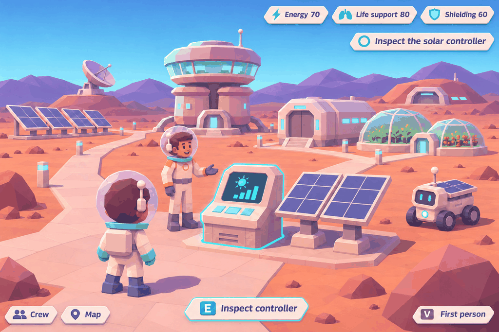

# Frente C — mapa, distribución del escenario y navegación

Trabajás en Solar Shield, un juego educativo bilingüe (inglés primero) sobre Marte para chicos de 7 a 10
años. Tu frente hace que la base esté organizada como una base real en Marte y como la lámina de referencia,
que el mapa se lea de un vistazo (hoy son 10 números sobre un cuadro naranja) y que el niño siempre sepa
adónde ir. Otras cinco personas trabajan en paralelo.

## Leé antes de tocar código
1. `CLAUDE.md` (raíz).
2. `docs/referenciapau/PLAN-JUGABILIDAD.md`: §0, §1, §3, tu frente en §4, §5 y §6.
3. `docs/referenciapau/ESCENAS.md` §3.2 (lugares), §3.3 (organización de la base) y §3.4 (panel `Map`).
4. **La lámina que manda:** `docs/referenciapau/referencias/exterior/03-exterior-organizacion.png`. El
   exterior tiene que quedar así. También `exterior/02-kit-entorno-cultivos.png`, `mundo/01` y `mundo/02`.
5. `ui/src/escena/mundo.ts`, `ui/src/componentes/Mapa.tsx` y `ui/src/escena/navegacion.ts`.

## Láminas

**Qué mirar: la base tiene que quedar así (lámina que manda).**

Qué mirar: el kit del entorno y los cultivos.

Qué mirar: la vista del exterior para ubicar lugares y caminos.

Todas las láminas: [docs/referenciapau/referencias/](../referencias/)

## Tus archivos (solo vos los editás)
`ui/src/escena/mundo.ts`, `ui/src/escena/activos/caminos.ts`, `ui/src/escena/marcadores.ts` (nuevo),
`ui/src/componentes/Mapa.tsx`, `ui/src/componentes/Mapa.css`, `ui/src/pantallas/PantallaSitio.tsx`,
`ui/src/pantallas/sitio.css`, `docs/referenciapau/mapa-base-jezero.svg`. En `ui/i18n/*.json` agregás
claves `ui.mapa.*`.

## Tus tareas, en orden
- **C1:** referencias reales (`docs/referenciapau/REFERENCIAS-BASE.md` con enlaces): conceptos de base de
  NASA, análogos (Mars Dune Alpha/CHAPEA, MDRS) y la lámina. Qué es real y por qué, cada afirmación con
  fuente.
- **C2:** redistribuir la base en `mundo.ts` para que quede como `exterior/03`: plataforma con nave arriba a
  la izquierda, energía a la izquierda, cúpula de control al centro con corredores, invernadero geodésico
  arriba a la derecha, laboratorio y enfermería a la derecha, comedor y descanso abajo, refugio de regolito
  abajo a la izquierda, dos caminos en anillo con balizas. **Sin `LugarId` nuevos.** Lo aprueba María Paula
  antes de fusionar. Es un cambio grande y compartido: fusionalo pronto en el bloque 1.
- **C3:** mapa nuevo: plano dibujado con la familia v8, placas con icono y nombre corto, caminos, módulos
  construidos frente a anclajes vacíos, el niño con su rumbo y el objetivo en cian con pulso. Tocar un lugar
  fija el destino y el niño camina.
- **C4:** destino en el mundo con `marcadores.ts` (gancho de A0): haz de luz, ruta en el piso con
  `planearRuta`, flecha en el borde si queda fuera de cuadro.
- Después: C5 (pines de E4 con icono y nombre) y C6 (brújula, P2).

## Qué esperás y qué entregás
- Esperás: C2 → C1 y la aprobación de María Paula; C3 → C2; C4 → A0 y A2 (mientras tanto, un `objetivo`
  fijo en `escena/vistaPrevia.ts`).
- Entregás: C2 a D (dónde ubicar los edificios) y a A (puertas y colisiones). Después de fusionar C2,
  avisá: todos hacen rebase.

## Reglas
- Las posiciones viven solo en `mundo.ts`; la forma de los edificios es del frente D. Nadie copia
  coordenadas en dos lugares.
- Sin GLB ni librerías nuevas. Presupuesto por vista: 80 draw calls y 80 000 triángulos.
- Textos por i18n, inglés primero. Sin emojis. Commits chicos en español, sin atribución a IA.
- Rama por tarea desde `origin/develop`; PR hacia `develop`; nunca empujes a `develop` ni a `main`.
- Antes de cada PR: typecheck, vitest, build, e2e y capturas en los 4 tamaños (más una cenital junto a la
  lámina para C2).

## Cómo informar cada tarea
Qué verificaste (comando y resultado), qué no verificaste y qué está bloqueado.
