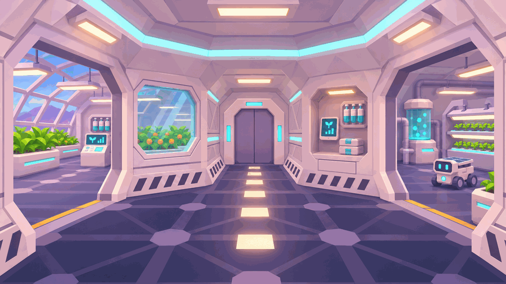
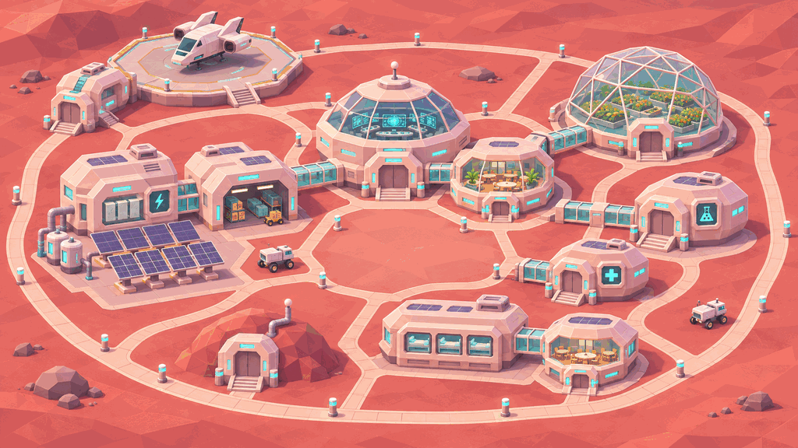
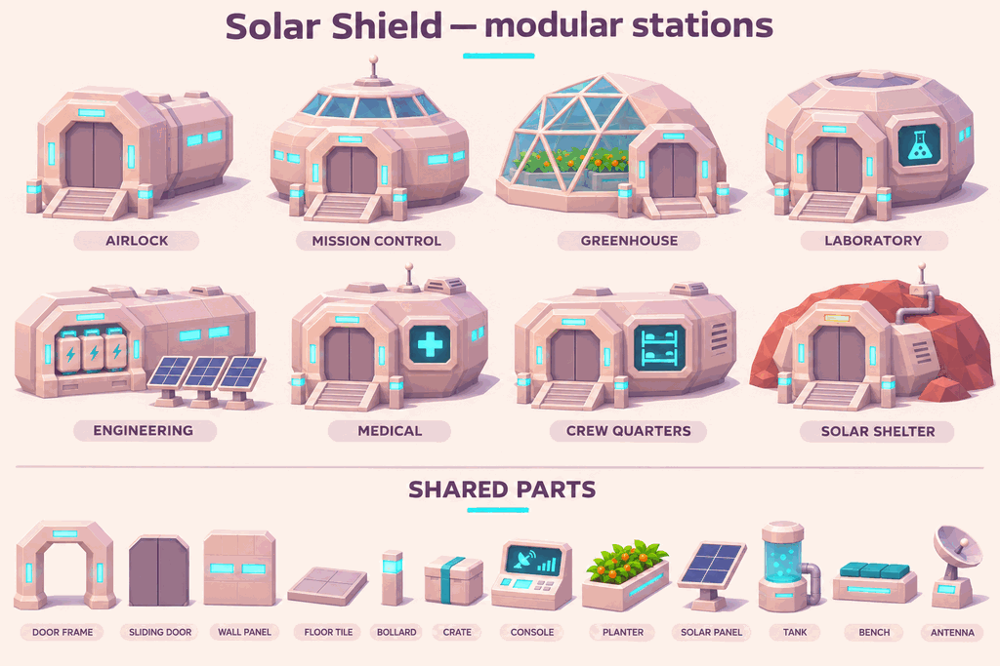
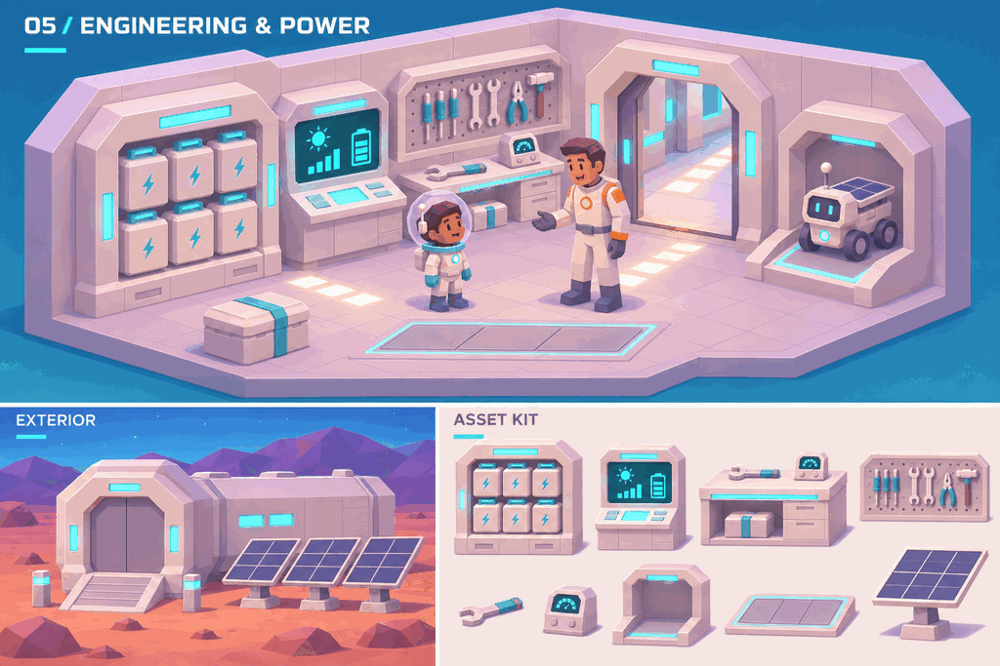
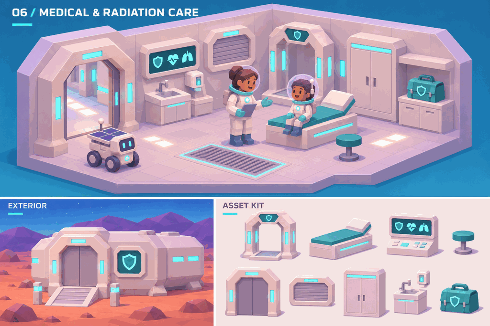
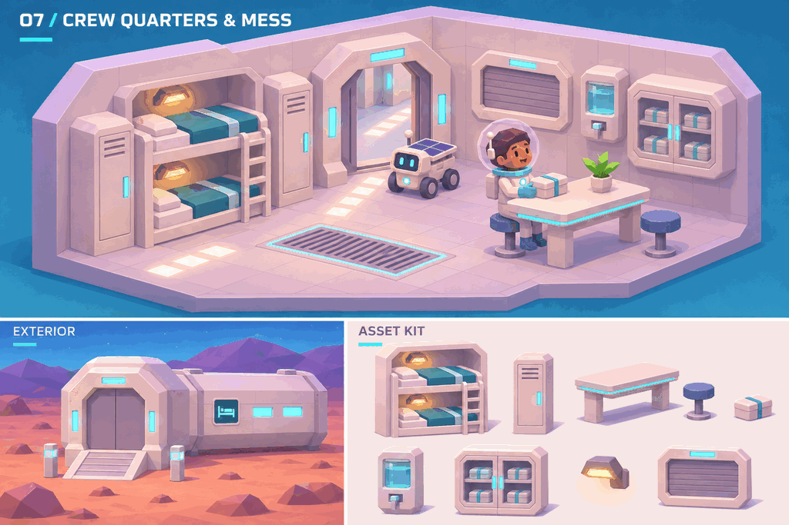
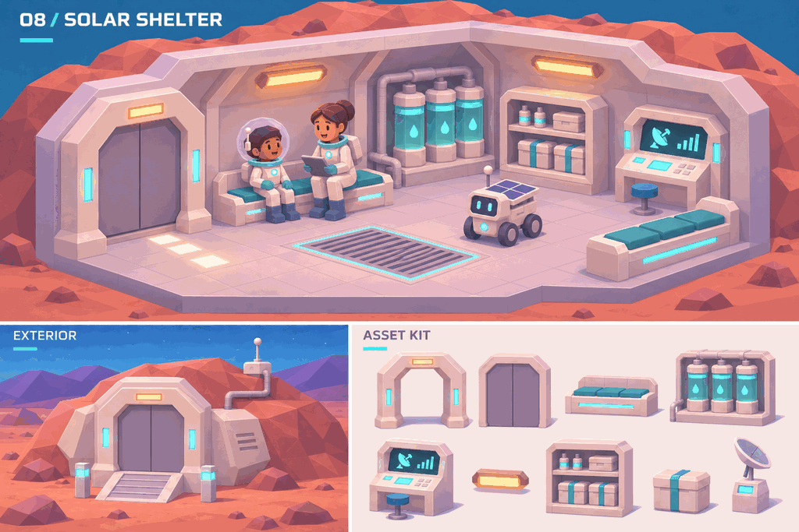
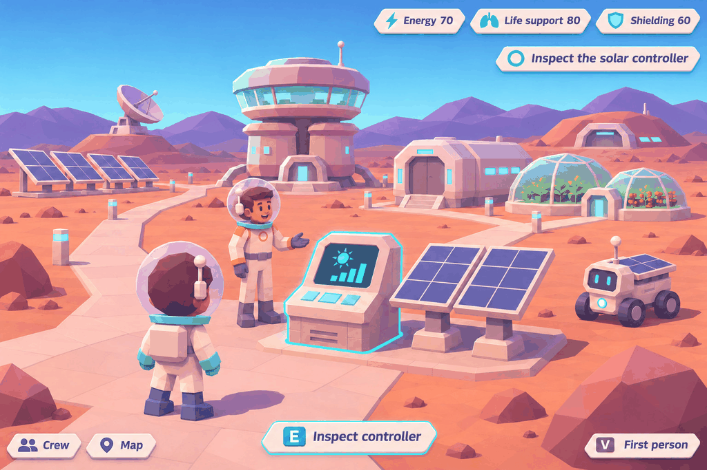

# Frente D — mallas, fidelidad, luz, día, detalle y rendimiento

Trabajás en Solar Shield, un juego educativo bilingüe (inglés primero) sobre Marte para chicos de 7 a 10
años. Tu frente hace que cada objeto se reconozca y se vea como en las láminas, que la luz cuente la hora
del día, que Marte se sienta real y que la escena corra fluida. También construís los interiores a los que
el niño entra. Otras cinco personas trabajan en paralelo.

## Leé antes de tocar código
1. `CLAUDE.md` (raíz).
2. `docs/referenciapau/PLAN-JUGABILIDAD.md`: §0, §1, §3, tu frente en §4, §5 y §6.
3. `docs/referenciapau/MARTE.md` (luz, color, cielo), `DISEÑO.md` y `ESCENAS.md` §4 (estaciones y las 7
   comprobaciones de §4.3).
4. Láminas: `docs/referenciapau/referencias/exterior/` (01 corredores, 02 kit, **03 organización**),
   `estaciones/01` a `08`, `mundo/01` y `mundo/02`.
5. `ui/src/escena/armado.ts`, `ui/src/escena/cielo.ts` y `ui/src/escena/activos/`.

## Láminas

Qué mirar: corredores y conexiones entre salas (D5).

Qué mirar: la organización de la base (D1 y la distribución de C2).

Qué mirar: las estaciones y sus piezas en conjunto.

Qué mirar: el taller, estación 05 (D5).

Qué mirar: la enfermería, estación 06 (D5).

Qué mirar: el descanso y el comedor, estación 07 (D5).

Qué mirar: el refugio, estación 08 (D5).

Qué mirar: luz, color y cielo del exterior (D3).

Todas las láminas: [docs/referenciapau/referencias/](../referencias/)

## Tus archivos (solo vos los editás)
`ui/src/escena/activos/**` (salvo `caminos.ts`), `ui/src/escena/armado.ts`, `ui/src/escena/cielo.ts`,
`ui/src/escena/calidad.ts` (después de A0), `ui/src/escena/cicloDia.ts` (nuevo), y la malla de los
personajes (`personajes/cuerpo.ts`, `cabeza.ts`, `malla.ts`, `rostro.ts`, `superficie.ts`, `iris.ts`)
**coordinado con María Paula, que los diseñó**.

## Tus tareas, en orden
- **D1:** fidelidad de mallas contra las láminas (módulos, hábitats, corredores, edificios de la
  distribución nueva). Lo aprueba María Paula.
- **D2:** la sombra del personaje que falla al caminar (probá el sesgo de sombra, que la cámara de sombra
  siga al niño y el tamaño del mapa de sombra); sombra de contacto para que nadie flote; calidad por nivel.
- **D4:** rendimiento: ≥ 30 fps en `media` en una laptop común. Hoy, sin GPU: `media` 17 a 26 fps en la
  base, `baja` 46 a 55. Medí con `medir: true` (`escena3d.ts:45`) antes y después.
- **D5:** interiores: el corredor de conexión como `exterior/01-corredores-conexiones.png` y después el
  taller (estación 05) y el hábitat (06 a 08). Cada sala es su propia vista; José la conecta (A8).
- **D3:** día y atardecer con `cicloDia.ts` (gancho de A0). El sol dura 24,6597 h (NASA NSSDC). En Jezero la
  luz pasa de día a tarde y al atardecer azulado al final. **Sin noche jugable** hasta que el motor modele
  que de noche el panel no da energía (escribí la regla con José).
- Después: D6 (remolinos de polvo, Fobos y Deimos, polvo con viento, la nave en la plataforma, cada uno con
  fuente verificada por el frente B) y D7 (la tormenta en el cielo y la luz).

## Qué esperás y qué entregás
- Esperás: D1 (ubicación) → C2; D3, D6 y D7 → A0; D4 → A0 (`calidad.ts`). Mientras tanto: la forma de cada
  malla por separado y prototipos en `escena/vistaPrevia.ts`.
- Entregás: D5 a José (A8). Si cambiás la malla de un personaje, avisá a María Paula: los retratos se
  regeneran con su guion.

## Reglas
- Sin GLB ni librerías nuevas. Presupuesto por vista: 80 draw calls y 80 000 triángulos (prueba en
  `escena3d.test.ts`).
- Nada de estatuas, ruinas, portales ni construcciones de piedra (ESCENAS §4.3).
- Commits chicos en español, sin atribución a IA. Sin emojis.
- Rama por tarea desde `origin/develop`; PR hacia `develop`; nunca empujes a `develop` ni a `main`.
- Antes de cada PR: typecheck, vitest, build, e2e y pares lámina/captura.

## Cómo informar cada tarea
Qué verificaste (comando y resultado, con fps antes y después), qué no verificaste y qué está bloqueado.
