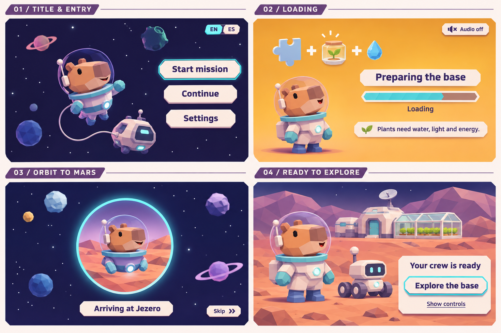
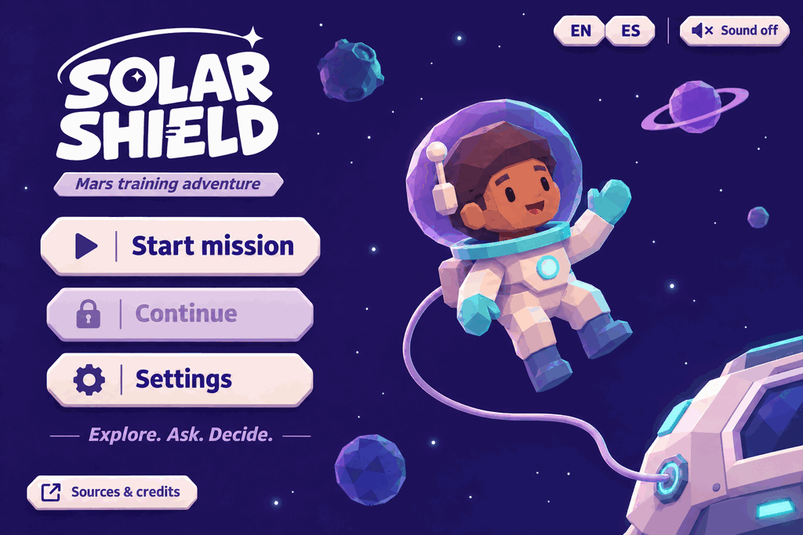
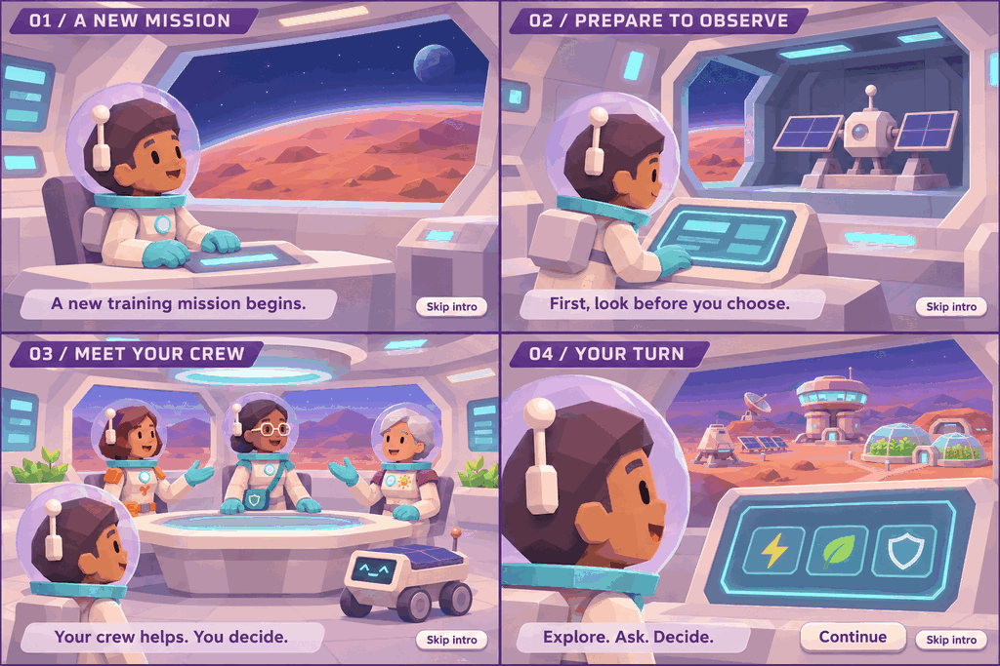
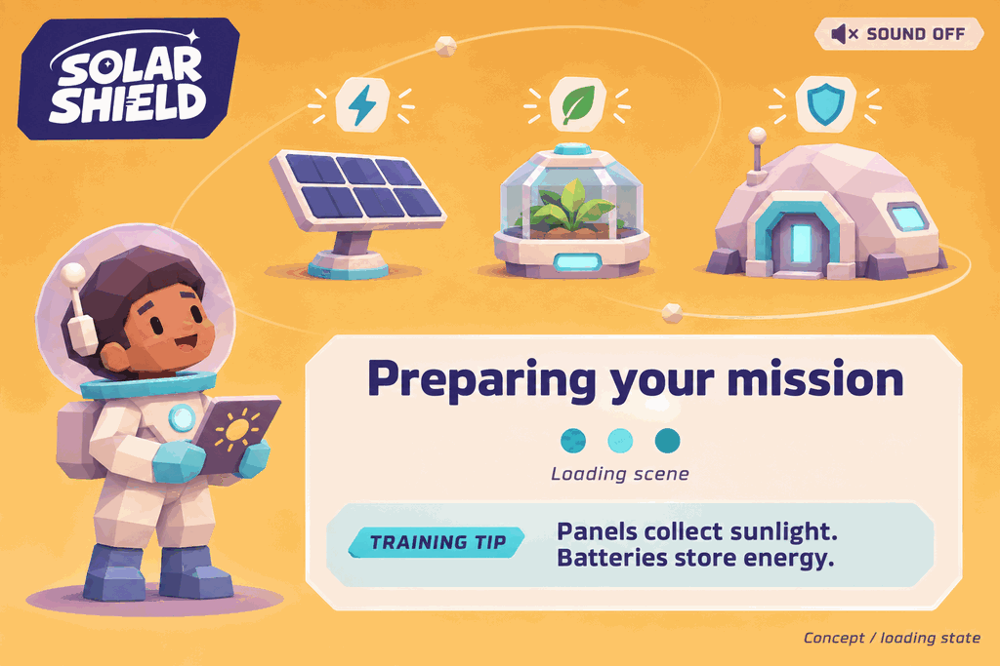
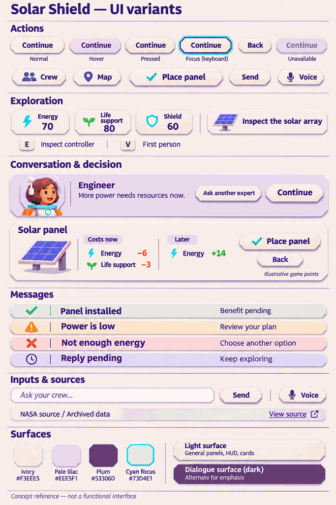

# Frente F — María Paula: UI visual, retratos B y fidelidad

Trabajás en Solar Shield, un juego educativo bilingüe (inglés primero) sobre Marte para chicos de 7 a 10
años. Tu frente pone las caras de la alternativa B en toda la interfaz, diseña cómo aparecen y se van las
tarjetas, y es la autoridad de referencia: aprobás el mapa, la distribución de la base y las mallas contra
las láminas. Otras cinco personas trabajan en paralelo.

## Leé antes de tocar código
1. `CLAUDE.md` (raíz).
2. `docs/referenciapau/PLAN-JUGABILIDAD.md`: §0, §1, §3, tu frente en §4, §5 y §6.
3. `docs/referenciapau/DISEÑO.md` (familia v8, tokens, §4.4 retrato y 3D comparten identidad).
4. Láminas: `referencias/inicio/04-flujo-entrada-carga-orbita-explorar.png` (composición; el personaje es el
   niño B, la capibara está descartada), `inicio/01` a `03`, `ui/`, `personajes/`.
5. `ui/src/escena/frontera.ts` (`CARAS_RETRATO_*` y `rutaRetrato`) y `ui/src/componentes/base/Retrato.tsx`.

## Láminas

Qué mirar: composición y orden; el personaje es el niño B, no la capibara.

Qué mirar: la pantalla de inicio actualizada (F6).

Qué mirar: los cuatro momentos de la intro.

Qué mirar: el panel de carga (F6).

Qué mirar: las variantes facetadas de la interfaz (F1 y F2).

Personajes: [personajes/](../referencias/personajes/)

Todas las láminas: [docs/referenciapau/referencias/](../referencias/)

## Tus archivos (solo vos los editás)
`ui/src/componentes/base/**`, todos los `.css` de `ui/src` (salvo `Mapa.css` y `sitio.css`, que son del
frente C), `tests/capturas/**`, `ui/public/retratos/**`.

## Tus tareas, en orden
- **F1:** retratos B: `tests/capturas/retratos.mjs` escribe `ui/public/retratos/<actor>-<cara>.png` con
  `rutaRetrato` y las caras de `frontera.ts` (persona: neutral, feliz, pensando, preocupado; Iris: atenta,
  feliz, pensando, error, apagada). `Retrato.tsx` usa el PNG, con el SVG actual como respaldo.
- **F2:** diseño de las tarjetas contextuales y sus transiciones (120 a 200 ms; sin movimiento con
  `prefers-reduced-motion`), en escritorio y celular. Santiago (E1) espera este estilo.
- **F3 (cuando lleguen los PR):** aprobás C2 (distribución), C3 (mapa) y D1 (mallas) contra las láminas.
  Escribí la aprobación o las diferencias en el PR.
- Después: F4 (estilo del globo, del aviso `[E]` y del botón de salto), F6 (pantallas de entrada según
  `inicio/04`) y F5 (revisión de capturas en cada encuentro).

## Qué esperás y qué entregás
- No esperás a nadie para F1, F2, F4 ni F6.
- Entregás: F2 a Santiago (E1); F4 a Santiago (E5, E9) y a José (estilo del globo); F6 a Santiago (E8); tus
  aprobaciones F3 destraban la fusión de C2, C3 y D1.
- Si el frente D cambia la malla de un personaje, volvés a correr `retratos.mjs`.

## Reglas
- Si hay lámina, manda la lámina.
- Textos por i18n, inglés primero. Sin emojis. Commits chicos en español, sin atribución a IA.
- Rama por tarea desde `origin/develop`; PR hacia `develop`; nunca empujes a `develop` ni a `main`.
- Antes de cada PR: typecheck, vitest, build y capturas en 1440x900, 1024x683, 844x390 y 390x844.

## Cómo informar cada tarea
Qué verificaste (comando y resultado), qué no verificaste y qué está bloqueado.
