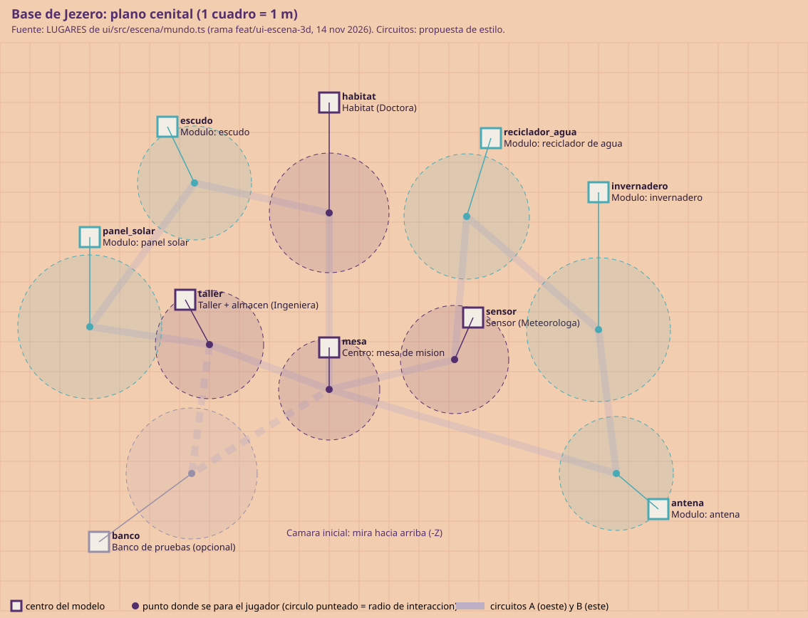
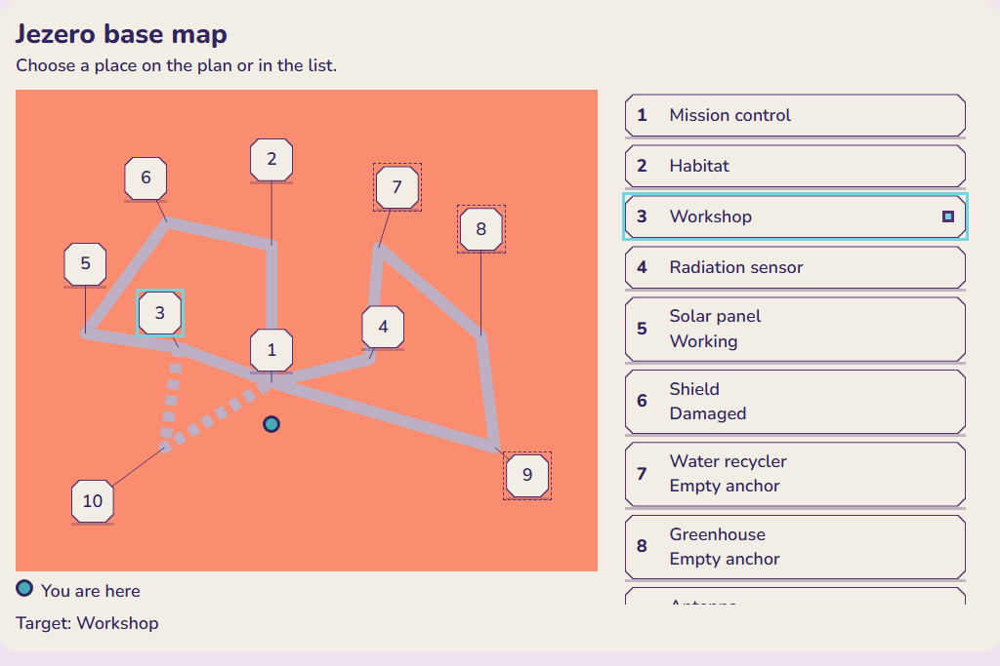

# Mapa de Jezero: evidencia y entrega

Componente aislado, sin montaje en App ni afirmación de navegación 3D integrada.
Capturas reales de Chromium con Nunito y los tokens oficiales de Jaime, tomados sin
modificarlos del commit público `3195f53` de Jaime.
La base ya incluye el contrato #205 y los tokens/Nunito mediante #220. El montaje
mantiene esa revisión histórica para reproducir las capturas; no define colores alternativos.

## Ficha de fidelidad (FLUJO §7.1)

- Lámina canónica: [plano de Jezero](../../../docs/referenciapau/mapa-base-jezero.svg),
  ESCENAS §3.2–3.4 y la familia de superficies de `ui/03`; `exterior/03` da los sectores.
  No existe una lámina PNG específica del panel Map: ESCENAS §3.4 lo define como propuesta.
- Captura: servidor local `127.0.0.1:5175`, montaje exclusivo del componente; no es el preview.
- Silueta: placas con chaflán, superficie marfil y texto índigo; mapa cenital simplificado,
  sin reproducir edificios 3D. El foco exterior no se recorta.
- Layout: posiciones de modelos y puntos de uso derivadas de LUGARES; oeste a izquierda
  y −Z arriba como el plano. Los números enlazan plano y lista, sin duplicar coordenadas.
  No se certifica la tolerancia del 2 % contra un PNG del panel que no existe.
- Material: variables oficiales `marfil`, `lila`, `ciruela`, `cian`, `indigo-texto`,
  `regolito-claro`, `camino`, `teal`, sombras y tipografía Nunito de Jaime. Ningún hex propio.
- Conducta: clic, Enter y Espacio solicitan el mismo LugarId. Módulos ausentes tienen
  contorno discontinuo y texto; instalando, funcionando y averiado tienen texto explícito.
  El objetivo se distingue por contorno y etiqueta; la posición no decide recursos.
- Desviación propuesta para revisión de Paula: adaptación del plano técnico a placas numeradas
  y lista desplazable de la familia v8; no se presenta como fidelidad aprobada.
- DISEÑO §8: sin emojis, tema anterior, degradados, iconos externos ni texturas de las láminas.

| Referencia de posiciones | Componente, 1024 × 683 |
| --- | --- |
|  |  |

Las otras capturas: [844 × 390](captura-844x390.png) y [390 × 844](captura-390x844.png).
La lista conserva los diez lugares y permite desplazamiento; no se ocultan por fase.
Se revisaron visualmente las tres capturas. La aceptación de fidelidad corresponde a Paula.

## Reproducción y resultados

Desde la raíz del worktree: `node ui/evidencias/mapa/verificar.mjs [ref-de-tokens]`.
El script crea un montaje en `build/qa-mapa/`, sirve los tokens y fuentes oficiales desde
Git y regenera las tres capturas. Requiere Chromium de Playwright y el commit indicado.
La referencia se resuelve con `git rev-parse --verify <ref>^{commit}` antes de leer archivos;
`resultados.json` conserva solo sus primeros siete caracteres para evitar la alerta de entropía.
La prueba no modifica tokens, App, mundo, motor ni archivos de colisiones.

- `npm.cmd run typecheck`: exit 0.
- `npm.cmd test`: 82 archivos, 598 pruebas sobre la base v8 incorporada; exit 0.
- `npm.cmd run build`: exit 0 (aplicación vigente; el mapa aún no está montado en ella).
- `npm.cmd run e2e`: ruta dorada en inglés, 1/1; exit 0.
- Mapa, navegación e i18n: 10/10 pruebas focalizadas; exit 0.
- Montaje del mapa: 30 clics, Enter/Espacio en los tres tamaños, EN/ES, posición y estados
  actualizables, movimiento reducido y superficies táctiles de al menos 44 px; exit 0.
  [Resultado legible por máquina](resultados.json). Sin errores de JavaScript observados.
- `git diff --check`: exit 0. Logs de los cuatro comandos en `build/qa-mapa/`.

## Qué conecta José

Importar `Mapa` desde `ui/src/componentes/Mapa.tsx` y pasar `posicion: {x,z}` de la escena,
`objetivo: LugarId | null`, `modulos: vista.modulos` y `onIrA(id)`.
El callback recibe el identificador, no el centro del edificio: resolver `lugar(id).x/z`
para solicitar la navegación o situar al niño en el punto de uso del respaldo 2D.
El componente no cambia posición, objetivo, pausa, GameState ni módulos internamente.
José conserva el contenedor de apertura/cierre, la pausa previa y la restauración del foco.

El contrato #205 y los tokens/Nunito de Jaime (#220) ya están en la base incorporada.
Faltan la aprobación visual de Paula y el callback de navegación de Daniel/José. El PR solo añade
sus claves `ui.mapa.*`, conforme a FLUJO §1.1. No requiere cambiar contratos ni balance.

## GitGuardian: incidente histórico 40101509

El hallazgo corresponde a `tokensRef` en el commit anterior `44a344d`: su valor era el
SHA completo del commit público `3195f53` de fuentes Nunito de Jaime, no una credencial.
La evidencia actual y el valor predeterminado del script usan siete caracteres.
Si el check conserva el hallazgo por el historial publicado, un mantenedor debe clasificarlo
como falso positivo en GitGuardian. No se reescribe historial ni se hace force push.
